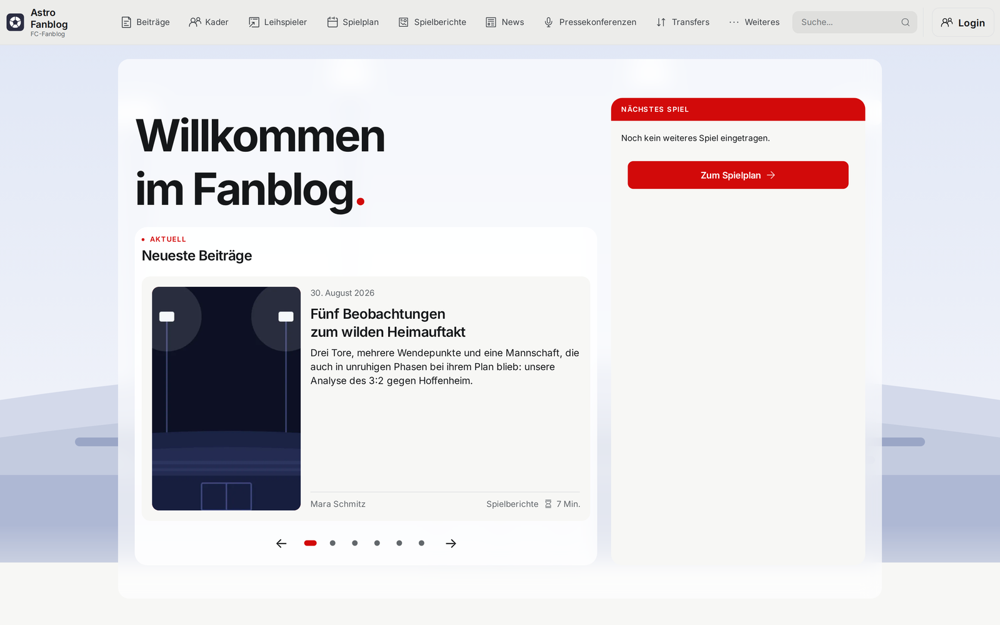
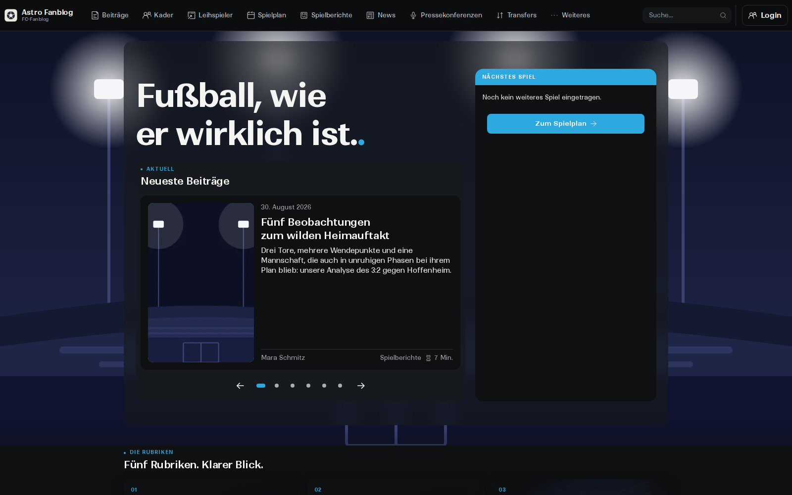
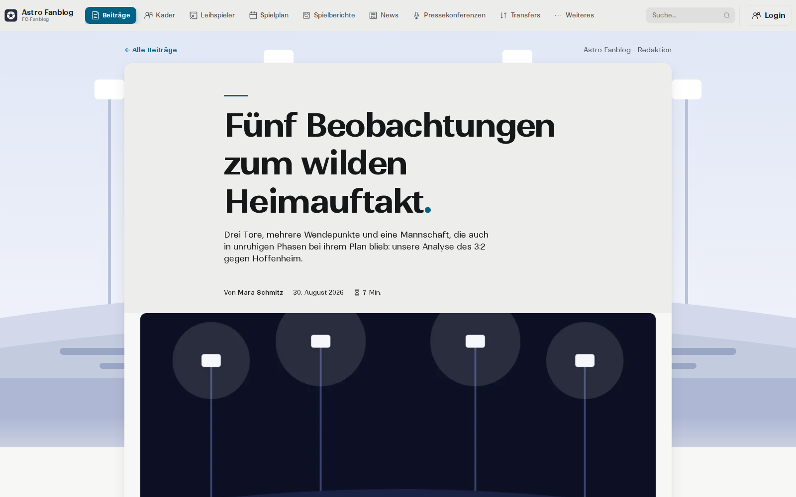
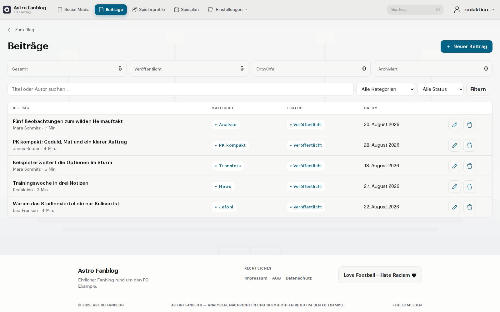
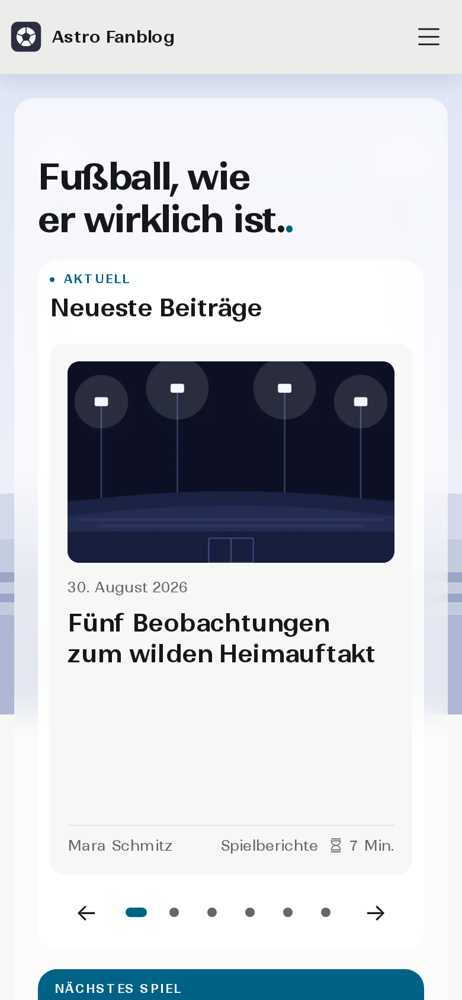
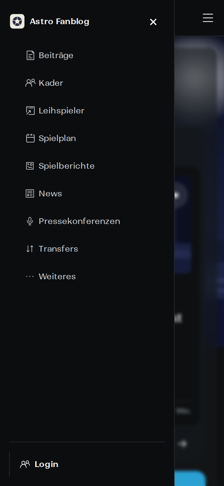
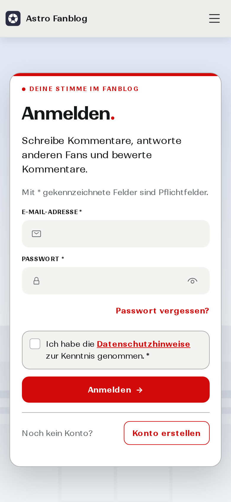

<p align="center">
  <picture>
    <source media="(prefers-color-scheme: dark)" srcset="public/logo/logo-icon-dark.svg" />
    
  </picture>
</p>

<h1 align="center">Astro Fanblog</h1>

<p align="center">
  <b>Open-source blog software for football fan communities, built with Astro&nbsp;7 and Supabase.</b><br />
  News, match reports, squad, loans, schedule and a community section — bring your own club, colors and content.
</p>

<p align="center">
  <a href="https://github.com/FelixW24/astro-fanblog/actions/workflows/ci.yml"></a>
  <a href="LICENSE"></a>
  <a href="https://astro.build"></a>
  <a href="https://supabase.com"></a>
  <a href="https://www.typescriptlang.org"></a>
  <a href="https://nodejs.org"></a>
</p>

## Brand colors

The UI uses a neutral palette — deliberately away from club colors like
red-and-white — inspired by the traditional Japanese colors on
[nipponcolors.com](https://nipponcolors.com). Tokens live in
[`src/styles/tokens.css`](src/styles/tokens.css) (see
[`design.md`](design.md)):

| Swatch | Nippon color | Hex | Role |
| ------ | ------------ | --- | ---- |
| <span style="display:inline-block;width:14px;height:14px;border-radius:4px;background:#006284;border:1px solid rgb(0 0 0 / 15%)"></span> | 縹 Hanada | `#006284` | accent (light mode) |
| <span style="display:inline-block;width:14px;height:14px;border-radius:4px;background:#113285;border:1px solid rgb(0 0 0 / 15%)"></span> | 紺青 Konjō | `#113285` | accent hover (light mode) |
| <span style="display:inline-block;width:14px;height:14px;border-radius:4px;background:#2ea9df;border:1px solid rgb(0 0 0 / 15%)"></span> | 露草 Tsuyukusa | `#2ea9df` | accent (dark mode) |
| <span style="display:inline-block;width:14px;height:14px;border-radius:4px;background:#58b2dc;border:1px solid rgb(0 0 0 / 15%)"></span> | 空 Sora | `#58b2dc` | accent hover (dark mode) |
| <span style="display:inline-block;width:14px;height:14px;border-radius:4px;background:#a5dee4;border:1px solid rgb(0 0 0 / 15%)"></span> | 瓶覗 Kamenozoki | `#a5dee4` | text selection (light) |
| <span style="display:inline-block;width:14px;height:14px;border-radius:4px;background:#566c73;border:1px solid rgb(255 255 255 / 15%)"></span> | 藍鼠 Ainezumi | `#566c73` | text selection (dark) |
| <span style="display:inline-block;width:14px;height:14px;border-radius:4px;background:#1c1c1c;border:1px solid rgb(0 0 0 / 15%)"></span> | 墨 Sumi | `#1c1c1c` | ink (near-black) |

## About

Astro Fanblog is a neutral, fully self-hostable fan blog platform: an editorial
front end for fans, a protected admin panel for the editorial team, and a
Supabase backend with row-level security throughout. The UI ships in German —
rebrand it for your club in minutes (logo in `public/logo/`, copy in
`src/pages/` and `src/components/`).

- **Status:** v0.1.0, actively maintained
- **License:** [MIT](LICENSE)

## Features

- **Editorial blog** — articles with categories, a safe Markdown pipeline
  (remark/rehype with sanitization), reading time, and an autosaving editor
- **Matchday hub** — fixture list (Spielplan) with per-match pages and a
  "next match" API
- **Squad & loans** — player profiles (Kader), including loan players in and out
- **Community** — reader accounts with e-mail confirmation and profiles, comments
  with votes and ratings, reply notifications, and GDPR-compliant account deletion
- **Moderation** — comment moderation, a comment blocklist, and temporary write
  suspensions
- **Newsletter** — double opt-in with signed confirmation/unsubscribe links and an
  admin export
- **Admin panel** (`/admin`) — articles, players, fixtures, users, moderation,
  blacklist, newsletter, a social-media studio, security dashboard, and tracking
- **Security by default** — Supabase Auth via SSR, row-level security on every
  table, rate limiting, security headers, and editor rights granted only through
  protected `app_metadata` flags
- **Theming & accessibility** — light/dark mode, design tokens via Panda CSS,
  semantic HTML, accessible names, and visible keyboard focus (see
  [`design.md`](design.md))
- **SEO & feeds** — sitemap, `robots.txt`, RSS feed, canonical URLs and Open Graph
- **Observability** — Sentry-compatible error reporting (e.g. self-hosted GlitchTip)

## Screenshots

Screenshots from the local dev environment with seed data (desktop 1440×900, mobile 390×844):

<p align="center">
  
</p>

<p align="center">
  
  
</p>

<p align="center">
  
</p>

<p align="center">
  
  
  
</p>

## Tech stack

| Layer        | Technology                                                            |
| ------------ | --------------------------------------------------------------------- |
| Framework    | [Astro 7](https://astro.build) — SSR with the standalone Node adapter |
| Language     | TypeScript (strict mode)                                              |
| Styling      | Panda CSS + CSS custom properties (design tokens)                     |
| Backend      | [Supabase](https://supabase.com) — PostgreSQL, Auth, row-level security |
| E-mail       | Nodemailer over SMTP                                                  |
| Monitoring   | Sentry-compatible DSN (e.g. self-hosted GlitchTip)                    |
| Tests        | Vitest (unit), Playwright (E2E), `node:test` (script checks)          |
| Tooling      | ESLint, Prettier, GitHub Actions, Make                                |

## Quick start

**Prerequisites:** Node.js ≥ 22.23.4, Docker, Git; `make` and `tmux` for the
convenience targets.

```sh
git clone https://github.com/FelixW24/astro-fanblog.git
cd astro-fanblog
npm ci
cp .env.example .env.local
npm run supabase:start    # start local Supabase (Docker)
npm run supabase:status   # copy the PUBLISHABLE_KEY into .env.local
make dev                  # Supabase + Astro with hot reload, in a tmux session
```

Without tmux, plain `npm run dev` works once Supabase is running.

| Service         | URL                        |
| --------------- | -------------------------- |
| Website         | http://localhost:4321      |
| Supabase Studio | http://127.0.0.1:55323     |

Real credentials belong only in `.env.local` — never in the repository and never
in `PUBLIC_*` variables. The legal pages (`/impressum`, `/datenschutz`, `/agb`)
ship with placeholder data — fill in your own details before going live.

## Commands

| Command                     | Purpose                                             |
| --------------------------- | --------------------------------------------------- |
| `make dev`                  | local Supabase + Astro dev server with hot reload   |
| `npm run dev`               | Astro dev server on port 4321 (Panda codegen first) |
| `npm run build`             | production build (standalone)                       |
| `make tmux`                 | production build + preview in a tmux session        |
| `npm start`                 | run the standalone server (`node server.mjs`)       |
| `npm test`                  | Vitest unit tests + admin-setup check               |
| `npm run test:coverage`     | unit tests with enforced coverage thresholds        |
| `npm run test:e2e`          | Playwright browser tests in Chromium (port 4330)    |
| `npm run lint`              | ESLint over JS/TS/Astro                             |
| `npm run check`             | regenerate styles + Astro type check                |
| `npm run format`            | Prettier                                            |
| `npm run supabase:start`    | start local Supabase                                |
| `npm run supabase:stop`     | stop local Supabase                                 |
| `npm run supabase:reset`    | reapply migrations and seed (destroys local data)  |
| `npm run supabase:status`   | show local keys/URLs                                |
| `npm run supabase:types`    | regenerate `src/lib/database.types.ts`              |
| `npm run supabase:db:test`  | verify RLS policies                                 |
| `make test`                 | full local suite: build, lint, types, unit, RLS, E2E |
| `make test-essential`       | slim CI-mode suite (core E2E flows only)            |

## Project structure

```
├── src/
│   ├── pages/       # Astro routes: public pages, /admin, /api
│   ├── components/  # reusable UI components (PascalCase)
│   ├── layouts/     # page layouts
│   ├── lib/         # business logic and data helpers (+ colocated *.test.ts)
│   └── styles/      # shared CSS and design tokens
├── public/          # static assets (logos in public/logo/, backgrounds, images)
├── supabase/        # migrations, seed data and mail templates
├── e2e/             # Playwright scenarios
├── scripts/         # automation scripts (setup, checks, tests)
└── ...
```

Do not edit generated directories: `dist/`, `.astro/`, `coverage/`,
`styled-system/`.

## Testing & quality gates

- `npm test` — Vitest unit tests plus the admin-setup check
- `npm run test:coverage` — enforces 85% statements/functions/lines and 80%
  branches on the configured `src/lib/` modules
- `npm run test:e2e` — Playwright end-to-end tests in Chromium
- `npm run supabase:db:test` — database RLS policy checks
- `make test` — everything above plus build, lint, and type check
- GitHub Actions runs the same gates on every push and pull request

## Configuration

Everything is configured through environment variables — see
[`.env.example`](.env.example) for the full, commented list. Copy it to
`.env.local` and fill in your values; `.env.local` is git-ignored.

| Variable                              | Purpose                                                        |
| ------------------------------------- | -------------------------------------------------------------- |
| `PUBLIC_SUPABASE_URL`                 | public Supabase URL                                            |
| `PUBLIC_SUPABASE_PUBLISHABLE_KEY`     | public anon/publishable key (safe for the browser)             |
| `SUPABASE_AUTH_SECRET_KEY`            | signs Supabase auth tokens — server only, never expose         |
| `SITE_ORIGIN`                         | canonical origin of the site (build time and runtime)          |
| `PUBLIC_SENTRY_DSN`                   | optional Sentry-compatible DSN for error reporting             |
| `MAIL_SMTP_HOST/PORT/USER/PASSWORD`   | SMTP settings for transactional mail                           |
| `EDITOR_TRUST_SECRET`, `*_TOKEN_SECRET` | HMAC secrets for signed links — unique, 32+ chars in production |

Security notes: row-level security is enabled on all exposed tables, the
service-role key is never shipped to the client, and `EDITOR_AUTH_BYPASS` only
works in the dev server — never set it in production.

## Deployment

The production build is a standalone Node server:

```sh
npm ci
npm run build
SITE_ORIGIN=https://your-domain.example npm start   # runs node server.mjs
```

- Set all environment variables on the server (table above); set
  `MIGRATIONS_AUTO_APPLY=0` if you want to apply migrations manually — by default
  missing migrations are applied automatically on start
- Put a reverse proxy in front of the Node process
- Use self-hosted Supabase or Supabase Cloud; migrations live in
  `supabase/migrations/`
- Replace the placeholder legal pages (`/impressum`, `/datenschutz`, `/agb`)
  with your own details

## Documentation

| Document                                | Contents                                          |
| --------------------------------------- | ------------------------------------------------- |
| [`docs/uebersicht.md`](docs/uebersicht.md) | simple project overview (German, no secrets)   |
| [`AGENTS.md`](AGENTS.md)                | repository guidelines (structure, style, tests)   |
| [`design.md`](design.md)                | design system and theming tokens                  |
| [`.env.example`](.env.example)          | full configuration reference with comments        |
| [`LICENSE`](LICENSE)                    | MIT license                                       |

## Contributing

1. Fork the repository and create a feature branch from `opensource`
2. Run `npm ci`, make your changes, and verify with `make test-essential`
   (fast core suite) or `make test` (full suite)
3. Commit in a concise, imperative style with an optional scope, e.g.
   `fix(admin): validate publication date`
4. Open a pull request against `opensource` describing the problem, the
   solution, and how you verified it

Code style: TypeScript strict, two-space indentation, single quotes, Prettier and
ESLint enforced; Astro components in PascalCase, routes as lowercase slugs. See
[`AGENTS.md`](AGENTS.md) for details.

## License

Released under the [MIT License](LICENSE) — Copyright (c) 2026 Felix Walter.
